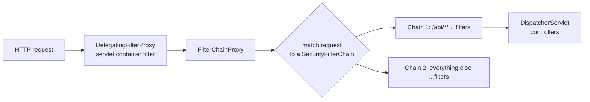
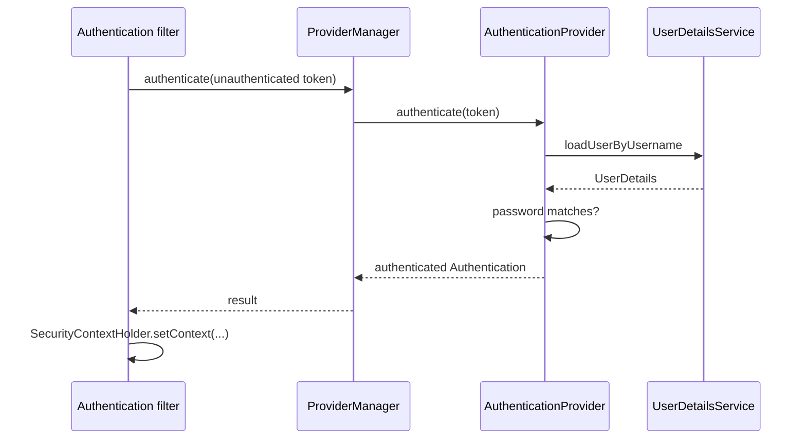

# Spring Security Architecture

<Outcomes items={[
  "Describe the filter chain and where authentication happens",
  "Configure SecurityFilterChain in Spring Security 6",
  "Explain CSRF, CORS and security headers"
]} />

## Where it sits



`FilterChainProxy` is the single entry point; it picks the **first** `SecurityFilterChain` whose request matcher matches. You can define several chains (for example a stateless token chain for `/api/**` and a session/form chain for the website).

Representative filters (order matters):

| Filter | Responsibility |
| --- | --- |
| `SecurityContextHolderFilter` | Loads the `SecurityContext` (e.g. from the session) into the `SecurityContextHolder` |
| `CsrfFilter` | Validates CSRF tokens for state-changing requests |
| `LogoutFilter` | Handles logout |
| `UsernamePasswordAuthenticationFilter` | Form login: builds an `Authentication` from credentials |
| `BearerTokenAuthenticationFilter` | Resource server: extracts and validates a bearer token |
| `ExceptionTranslationFilter` | Converts `AuthenticationException` to 401 (entry point) and `AccessDeniedException` to 403 |
| `AuthorizationFilter` | Final authorisation decision for the request |

## Core concepts

- **`Authentication`**: who is calling. Before authentication it holds credentials (username/password, token); afterwards the **principal** (identity) and **authorities** (`GrantedAuthority`, e.g. `ROLE_ADMIN`, `SCOPE_orders.read`).
- **`SecurityContext` / `SecurityContextHolder`**: holds the current `Authentication`, by default in a **`ThreadLocal`**. Important for async work and virtual/other threads: it is not propagated automatically (use `DelegatingSecurityContextExecutor` or `SecurityContextHolder.MODE_INHERITABLETHREADLOCAL` knowingly).
- **`AuthenticationManager`** (typically `ProviderManager`) delegates to a list of **`AuthenticationProvider`**s; the first that supports the token type and authenticates wins. `DaoAuthenticationProvider` uses a `UserDetailsService` plus a `PasswordEncoder`; JWT resource servers use `JwtAuthenticationProvider`.
- **`UserDetailsService`**: loads a user by username (from your DB, LDAP...).
- **Authorization**: `AuthorizationManager`s decide whether the `Authentication` may perform the action (URL rules, method annotations).



## Configuration (Spring Security 6 / Boot 3)

Configuration is a `SecurityFilterChain` bean using the lambda DSL. `WebSecurityConfigurerAdapter` is gone.

```java
@Configuration
@EnableMethodSecurity
class SecurityConfig {

    @Bean
    SecurityFilterChain apiFilterChain(HttpSecurity http) throws Exception {
        http
            .csrf(csrf -> csrf.disable())                                   // stateless bearer-token API (see CSRF below)
            .sessionManagement(s -> s.sessionCreationPolicy(SessionCreationPolicy.STATELESS))
            .authorizeHttpRequests(auth -> auth
                .requestMatchers("/public/**", "/actuator/health/**").permitAll()
                .requestMatchers(HttpMethod.GET, "/orders/**").hasAuthority("SCOPE_orders.read")
                .requestMatchers("/admin/**").hasRole("ADMIN")
                .anyRequest().authenticated())                               // default deny: always end with this
            .oauth2ResourceServer(oauth -> oauth.jwt(Customizer.withDefaults()));
        return http.build();
    }
}
```

Rules are evaluated **in order; first match wins**, so put specific rules before general ones and finish with `anyRequest().authenticated()` (or `denyAll()`). I tested this exact shape: unauthenticated → **401**; authenticated without the needed authority → **403**; token with the right scope → **200**.

### 401 vs 403

- **401 Unauthorized** (really "unauthenticated"): no or invalid credentials. Produced by the `AuthenticationEntryPoint` (adds `WWW-Authenticate`).
- **403 Forbidden**: authenticated, but not allowed. Produced by the `AccessDeniedHandler`.

Browsers/forms redirect to a login page on 401 in a form-login chain; APIs should return JSON errors (customise the entry point and handler).

## Roles vs authorities

A **role** is an authority with the `ROLE_` prefix: `hasRole("ADMIN")` checks the authority `ROLE_ADMIN`; `hasAuthority("ROLE_ADMIN")` is the same. OAuth2 scopes become `SCOPE_x` authorities. Keep roles coarse (ADMIN, USER) and use fine-grained permissions/scopes for operations.

## Passwords

Never store plain or fast-hashed passwords. Use a **slow, salted, adaptive** hash.

```java
@Bean
PasswordEncoder passwordEncoder() {
    return PasswordEncoderFactories.createDelegatingPasswordEncoder();    // {bcrypt}$2a$10$...
}
```

`DelegatingPasswordEncoder` prefixes stored hashes with an algorithm id (`{bcrypt}`, `{argon2}`, `{pbkdf2}`), so you can upgrade the algorithm later without invalidating existing passwords (`upgradeEncoding`). BCrypt salts automatically (encoding the same password twice yields different hashes) and its cost factor can be raised over time. Argon2 and scrypt are memory-hard alternatives. Never use MD5/SHA-1/SHA-256 alone for passwords.

## CSRF

Cross-Site Request Forgery tricks a logged-in browser into sending a state-changing request using its **automatically attached cookies/session**. CSRF protection (a per-session token that the attacker cannot read) is **on by default** and needed for **session/cookie-authenticated** apps.

- **Keep CSRF enabled** for server-rendered or cookie-session apps.
- It is safe to **disable** for APIs that authenticate with an `Authorization: Bearer ...` header (the browser does not attach it automatically), and that are stateless.
- If you store a JWT in a cookie, you are back in CSRF territory: use `SameSite` cookies plus CSRF protection.

## CORS

CORS controls which **browser origins** may call your API from JavaScript; it is not an authentication mechanism and does not stop non-browser clients. Configure it in Spring Security (`http.cors(...)` with a `CorsConfigurationSource`) so that pre-flight `OPTIONS` requests are handled before authentication; with `Access-Control-Allow-Origin: *` you cannot also allow credentials. List explicit origins.

## Security headers

Spring Security adds sensible defaults: `X-Content-Type-Options: nosniff`, `Cache-Control: no-store` for secured responses, `X-Frame-Options: DENY`, HSTS on HTTPS. Add a **Content-Security-Policy** for browser apps.

## Testing

```java
mvc.perform(get("/orders/1").with(jwt().authorities(new SimpleGrantedAuthority("SCOPE_orders.read"))))
   .andExpect(status().isOk());

@Test @WithMockUser(roles = "ADMIN")
void adminOnly() throws Exception { ... }
```

`spring-security-test` provides `@WithMockUser`, `jwt()`, `httpBasic()`, `csrf()` post-processors. Include negative tests for 401 and 403; most security bugs are missing checks.

## Check yourself

<Checkpoint questions={[
  {
    "q": "Where does Spring Security hook into a web request?",
    "options": [
      "A chain of servlet filters before the controller",
      "Inside every controller",
      "In the database",
      "In the browser"
    ],
    "answer": 0,
    "why": "DelegatingFilterProxy hands the request to the SecurityFilterChain."
  },
  {
    "q": "Which is the modern way to configure web security in Spring Security 6?",
    "options": [
      "Extend WebSecurityConfigurerAdapter",
      "Declare a SecurityFilterChain bean",
      "Edit web.xml",
      "Use @EnableOldSecurity"
    ],
    "answer": 1,
    "why": "The adapter was removed. Beans make the configuration explicit."
  },
  {
    "q": "Why can a stateless JWT API often disable CSRF protection?",
    "options": [
      "CSRF only affects databases",
      "JWTs are encrypted",
      "No session cookie is used for authentication, so browsers do not send credentials automatically",
      "CSRF was removed from browsers"
    ],
    "answer": 2,
    "why": "CSRF exploits automatic cookie sending. Header-based tokens are not attached by the browser."
  }
]} />

## Common interview questions

**1. Explain how Spring Security works.**
A `FilterChainProxy` delegates requests to a matching `SecurityFilterChain`; authentication filters build an `Authentication` via the `AuthenticationManager`/providers and store it in the `SecurityContext`; the authorization filter (and method security) then decide access. Exceptions are translated to 401/403.

**2. 401 vs 403?**
401: not authenticated (missing/invalid credentials). 403: authenticated but lacking permission.

**3. How do you secure a REST API with JWT?**
Run it as an OAuth2 resource server: stateless sessions, CSRF disabled, `oauth2ResourceServer().jwt()` validating signature, issuer and expiry, mapping scopes/roles to authorities, and `authorizeHttpRequests` rules plus method security.

**4. How are passwords stored?**
Hashed with a slow salted algorithm via `PasswordEncoder` (bcrypt/argon2), typically `DelegatingPasswordEncoder` for upgradability.

**5. When can you disable CSRF?**
For stateless APIs authenticated by a header token, not cookies. Keep it for session/cookie-based apps.

**6. What does `hasRole("ADMIN")` check?**
The authority `ROLE_ADMIN`.

**7. How does `SecurityContextHolder` work with threads?**
It uses a `ThreadLocal` by default; new threads (executors, `@Async`) do not see it unless you propagate it.

**8. How do you have different security for `/api` and the web UI?**
Define multiple `SecurityFilterChain` beans with `securityMatcher` and `@Order`.

**9. What is the order of rules in `authorizeHttpRequests`?**
First match wins: specific before general, ending with a catch-all.

## Pitfalls

- `permitAll()` on too broad a pattern or rules in the wrong order.
- Disabling CSRF for cookie-authenticated apps.
- `Access-Control-Allow-Origin: *` with credentials, or treating CORS as security.
- Relying on hidden UI elements instead of server-side checks.
- Missing default-deny `anyRequest()` rule.
- Security context lost in async execution.
- Custom filters that run before authentication and trust request headers (e.g. `X-User`) set by clients.

## Key takeaways

- Security = a filter chain + `Authentication` + authorization decisions.
- Rules are ordered; default-deny; 401 vs 403 semantics.
- Use delegating password encoders, keep CSRF on for cookie sessions.
- Test unauthorised paths as carefully as the happy path.

Next: [JWT and token-based auth](jwt.md).
