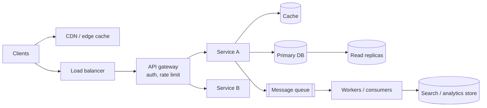

# Approaching a System Design Problem

<Outcomes items={[
  "Follow a repeatable framework in a design interview",
  "Do back-of-the-envelope estimates",
  "Show trade-off thinking"
]} />

## A framework (about 45 minutes)

| Step | Time | What you do |
| --- | --- | --- |
| 1. **Clarify requirements** | 5 min | Functional scope, non-functional goals, constraints, what is out of scope |
| 2. **Estimate scale** | 5 min | Users, requests per second, data volume, read/write ratio |
| 3. **API and data model** | 5-8 min | Core endpoints/events, main entities, access patterns |
| 4. **High-level design** | 10 min | Boxes and arrows: clients, gateway, services, data stores, queues, caches |
| 5. **Deep dives** | 15 min | The 2-3 hardest parts (the interviewer will steer): data partitioning, consistency, hot keys, failure handling |
| 6. **Trade-offs, failure, evolution** | 5 min | Bottlenecks, what breaks first, monitoring, how it grows |

State the plan aloud; it shows control and lets the interviewer redirect early.

### 1. Clarify requirements

**Functional** ("what does it do?"): list the 3-5 core use cases and **explicitly scope out** the rest ("I'll skip analytics dashboards and billing").

**Non-functional** ("how well?"): the real design drivers.

| Dimension | Questions |
| --- | --- |
| Scale | Daily active users? Peak requests per second? Data growth per year? |
| Latency | p99 target? (50 ms for a redirect, seconds for a report) |
| Availability | 99.9% (8.8 h/year down) or 99.99% (53 min/year)? Regional failover? |
| Consistency | Must reads see the latest write? Can the user tolerate stale data? Where are money or inventory involved? |
| Durability | Can we ever lose data? How long to retain it? |
| Security & compliance | Authentication, PII, GDPR, audit, tenant isolation |
| Cost & team | Budget, existing stack (Java/Spring/Kafka/PostgreSQL), team size and skills |

Write the answers down; refer back when justifying choices ("because we need p99 < 100 ms, I cache").

### 2. Back-of-envelope estimation

You are after the **order of magnitude**, not precision. Use round numbers and show the arithmetic.

Useful conversions:

- 1 day ≈ **86,400 s ≈ 10^5 s**; 1 month ≈ 2.5 million s; 1 year ≈ 31.5 million s (3×10^7).
- Average QPS = requests per day ÷ 10^5. **Peak ≈ 2-5× average** (state your assumption).
- Storage per year = records per day × 365 × record size. Multiply by **replication factor (3)** and add index/overhead (about 20-50%).
- Bandwidth = QPS × payload size.

**Latency numbers every engineer should know** (rough, modern hardware):

| Operation | Time |
| --- | --- |
| L1/L2 cache reference | 1-10 ns |
| Main memory reference | ~100 ns |
| Compress 1 KB | ~2 µs |
| SSD random read | ~100 µs |
| Round trip within a datacenter | ~0.5 ms |
| Read 1 MB sequentially from memory | ~0.25 ms |
| Read 1 MB from SSD | ~1 ms |
| Disk (HDD) seek | ~5-10 ms |
| Round trip across continents | ~100-150 ms |

Implications: memory is ~1000× faster than SSD access for random reads; network hops within a region cost about half a millisecond each (a call chain of 10 services is 5 ms of pure network before any work); cross-region synchronous calls blow a 100 ms budget.

**Worked example: a photo-sharing feed** (illustrative numbers)

- 50 M daily active users, each views feed 10 times a day → 500 M feed reads/day → **~5,000 reads/s average, ~15,000/s peak**.
- 5% of users upload 1 photo a day → 2.5 M uploads/day → **~25 writes/s** (read:write = 200:1: a read-heavy system, so cache and precompute).
- Photo 2 MB original + thumbnails ≈ 2.5 MB → 2.5 M × 2.5 MB = **~6 TB/day, ~2 PB/year** before replication: object storage + CDN, metadata in a database.
- Metadata row ~1 KB: 2.5 M/day → 2.5 GB/day → ~1 TB/year: fits a sharded relational or NoSQL store.

State assumptions out loud; interviewers care that you **reason**, and will correct a bad assumption.

### 3. API and data model

Sketch the **public contract** and the **entities**, driven by **access patterns** (what queries must be fast?).

```text
POST /v1/urls            { longUrl, alias?, expiresAt? }   -> 201 { shortUrl }
GET  /{code}                                              -> 302 Location: longUrl
```

For each entity name the **primary key and the main queries**; this decides the database and the partitioning key (see [relational design](../databases/relational-design.md), [NoSQL](../databases/nosql-and-redis.md)). Mention idempotency keys for non-idempotent writes and pagination for lists.

### 4. High-level design

Start with the simplest thing that meets the requirements, then evolve:



Start with a single region and a database, then add: caching for reads, replicas, a queue for async work, partitioning when writes or data exceed one node. **Do not start with 15 microservices and Kafka**; justify each component by a requirement.

### 5. Deep dives: where seniors stand out

Typical areas and what to say:

| Area | Points to cover |
| --- | --- |
| **Data partitioning** | Shard key choice, hot keys, rebalancing, consistent hashing ([sharding](../databases/replication-sharding.md)) |
| **Consistency** | Where is strong consistency required (money, inventory)? Where is eventual fine? Idempotency, sagas ([Saga](../microservices/data-consistency/saga.md)) |
| **Caching** | What, where (client, CDN, app, DB), invalidation, stampede ([Caching](../spring/data/caching.md)) |
| **Async processing** | Queues vs logs, ordering, retries, DLQ, backpressure ([Kafka](../messaging/kafka-fundamentals.md)) |
| **Failure handling** | Timeouts, retries with jitter, circuit breakers, graceful degradation ([Resilience4j](../microservices/resilience/resilience4j.md)) |
| **Hot spots / thundering herds** | Celebrity users, flash sales, cache expiry |
| **Observability** | SLOs, metrics, tracing, alerts ([Observability](../microservices/observability/observability.md)) |
| **Security** | AuthN/Z, abuse, data protection ([Security](../spring/security/security-architecture.md)) |

### 6. Trade-offs and wrap-up

End by naming: the **bottleneck** at 10× scale, what you would **monitor**, the **riskiest assumption**, and an **evolution path** (what you would add next). See [Trade-off discussions](tradeoffs.md).

## Building blocks cheat sheet

| Need | Typical building block | Java/Spring angle |
| --- | --- | --- |
| Entry, routing, auth | API gateway, load balancer | Spring Cloud Gateway, NGINX, cloud LB |
| Static/edge content | CDN | CloudFront, Fastly |
| Fast reads | Cache (aside), Redis, Caffeine | `@Cacheable`, Spring Data Redis |
| Source of truth | Relational DB (default), document/wide-column for scale | Spring Data JPA/JDBC |
| Async decoupling | Queue (RabbitMQ/SQS) or log (Kafka) | Spring Kafka/AMQP |
| Search | Elasticsearch/OpenSearch | Spring Data Elasticsearch |
| Files | Object storage (S3) | AWS SDK |
| Unique ids | Snowflake/UUIDv7, DB sequences | See [URL shortener](url-shortener.md) |
| Scheduling | Quartz/ShedLock, k8s CronJob, delayed queues | |
| Coordination | ZooKeeper/etcd, DB constraints | Spring Cloud |
| Observability | Prometheus, Grafana, OpenTelemetry | Micrometer |

## Habits that impress

- **Ask before drawing**; write requirements and numbers on the board.
- **Justify** every component with a requirement or number; avoid buzzwords.
- Discuss **failure modes** unprompted: what if the cache dies, a region fails, a consumer lags, a message duplicates?
- Prefer **simple, boring technology** where it meets the requirement; mention operational cost.
- Quantify: "5k QPS, so one PostgreSQL primary with replicas is fine; at 500k QPS I'd shard".
- Call out **trade-offs** explicitly; there is no best design, only best for these constraints.
- Keep the interviewer in the loop; adapt to hints.

## Check yourself

<Checkpoint questions={[
  {
    "q": "What should you do first in a system design interview?",
    "options": [
      "Clarify requirements and scope",
      "Draw the database",
      "Pick the programming language",
      "List every microservice"
    ],
    "answer": 0,
    "why": "Requirements and scale drive every later choice."
  },
  {
    "q": "100 million requests per day is roughly how many per second on average?",
    "options": [
      "About 10",
      "About 1,150",
      "About 100,000",
      "About 10 million"
    ],
    "answer": 1,
    "why": "100,000,000 / 86,400 is about 1,157 per second. Peak is usually a few times higher."
  },
  {
    "q": "What should you do when you pick a technology?",
    "options": [
      "Say it is industry standard",
      "Avoid mentioning alternatives",
      "Justify it against a requirement and name what you give up",
      "Skip trade-offs"
    ],
    "answer": 2,
    "why": "Interviewers look for reasoning, not buzzwords."
  }
]} />

## Common mistakes

- Jumping to technology (Kafka, Cassandra) before requirements.
- Skipping estimation, then over- or under-building.
- A single point of failure that is never discussed.
- Ignoring data consistency and idempotency.
- Over-engineering: microservices for a prototype, sharding for 10 GB of data.
- Not covering deployment, monitoring and operations.
- Silent when asked "what would break?"

## Common interview questions about the process

**1. How do you start a design question?**
Clarify functional and non-functional requirements, agree scope, then estimate scale before drawing anything.

**2. How do you estimate QPS and storage?**
Daily volume ÷ 86,400 for average QPS, peak at 2-5×; storage = records × size × retention × replication, plus overhead.

**3. How do you decide between SQL and NoSQL in a design?**
From access patterns, consistency needs and scale; default to relational unless a clear requirement (massive write throughput, flexible schema, multi-region writes) says otherwise.

**4. How do you handle a requirement you are unsure about?**
State an assumption, note its impact, proceed, and mention how the design changes if it is wrong.

## Key takeaways

- Requirements and numbers drive design; state them first.
- Start simple, add components only to meet a stated need.
- Deep dive on partitioning, consistency, caching, failure handling.
- End with bottlenecks, monitoring and evolution.
