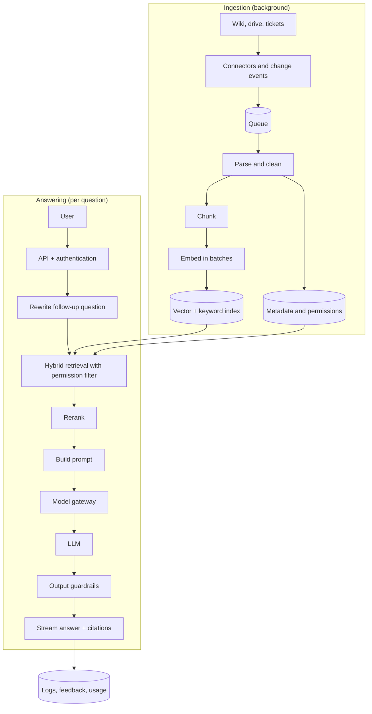

# Design a RAG Chatbot

<Outcomes items={[
  "Estimate traffic, token cost and storage for a RAG chatbot",
  "Draw the ingestion pipeline and the answering path, and say what each part does",
  "Handle access control, freshness, quality and failures",
]} />

## 1. Requirements

**Functional**

- Employees ask questions in plain language and get an answer **based on company documents**, with **citations**.
- The chatbot follows the conversation (follow-up questions work).
- Users only see answers built from documents **they are allowed to read**.
- Users can give feedback (thumbs up or down) on answers.

**Non-functional**

- First words of the answer appear in about **2 seconds**, and the full answer in under about 10.
- Documents are searchable within **an hour** of being changed.
- Availability about 99.9%, and a clear fallback when the model provider is down.
- Predictable cost, with a budget per user and per day.
- Out of scope for this design: training models, voice, and editing documents.

## 2. Estimation

- **Users and traffic:** 20,000 users ask 50,000 questions per day. That is 50,000 / 86,400, about **0.6 questions per second** on average. Plan for a peak of ten times, about **6 per second**.
- **Tokens per question:** about 3,000 input (instructions 300, history 500, four retrieved chunks of about 550 each) and 300 output.
- **Cost (example prices of $3 and $15 per million input and output tokens):** input 3,000 / 1,000,000 x 3 = $0.009, output 300 / 1,000,000 x 15 = $0.0045, so **$0.0135 per question**. Per day: 50,000 x 0.0135 = **$675**, about $20,000 per month before any savings.
- **Corpus:** 100,000 documents of about 5 chunks each is **500,000 chunks**. One embedding of 1,536 numbers at 4 bytes is about 6 KB, so vectors take 500,000 x 6 KB, about **3 GB**, plus the text and the index overhead. That fits comfortably in one PostgreSQL with pgvector, or a small dedicated cluster.

The takeaway: the vector store is small. **Model calls are the main cost**, so caching, shorter prompts and routing matter most.

## 3. High-level architecture

## 4. Ingestion pipeline

- **Connectors** read from each source (wiki, shared drive, ticket system). Prefer **change events** or incremental sync over re-reading everything.
- **Parse and clean:** extract text, keep headings and table structure where possible, drop boilerplate.
- **Chunk** by structure (headings, paragraphs) into a few hundred tokens with a little overlap, and store the heading path with each chunk so it can be shown as a citation.
- **Embed in batches** with the same model used for queries, and store the model name with each vector.
- **Upsert by document version.** When a document changes, replace all its chunks. When it is deleted, delete its chunks.
- **Capture permissions** (which groups can read the document) alongside the chunks.
- **Handle failures:** put failed documents on a dead-letter queue with the reason, and alert on a growing backlog.

## 5. Answering path

1. **Authenticate** the user and load their groups.
2. **Rewrite** a follow-up such as "and for contractors?" into a stand-alone question using the recent history.
3. **Retrieve** with hybrid search (keywords plus vectors), about 20 candidates, filtered to documents the user may read.
4. **Rerank** the candidates and keep the best 4.
5. **Build the prompt:** rules ("answer only from the documents, cite sources, say you do not know if the answer is missing"), the chunks with their sources, the history and the question.
6. **Call the model through the gateway,** and **stream** the answer.
7. **Check the output** (see guardrails), attach citations, and log the trace, the chunks used and the token counts.

## 6. Data model

| Table | Main columns |
| --- | --- |
| `documents` | id, source, uri, title, version, allowed_groups, updated_at |
| `chunks` | id, document_id, heading_path, text, embedding, model_name |
| `conversations` | id, user_id, created_at |
| `messages` | id, conversation_id, role, text, chunk_ids, tokens_in, tokens_out, cost |
| `feedback` | message_id, rating, comment |

## 7. Access control

- **Filter before the prompt.** The permission filter is part of the retrieval query. A chunk the user cannot read must never reach the model, because the model could repeat it.
- **Never cache across permission boundaries.** Include the user's groups (or a permission hash) in cache keys.
- **Keep permissions fresh.** If a document's access changes, update `allowed_groups` quickly, and re-check at query time for sensitive sources.
- **Treat document text as untrusted.** A page can contain instructions. The model should have no tools that send data out (see [Prompt injection](../ai/safety/prompt-injection-and-security.md)).

## 8. Quality and evaluation

- Build an **evaluation set** of real questions with the expected source documents and answers.
- Measure **retrieval** (is the right chunk in the top 20, and in the final 4?) and **generation** (is the answer supported by the chunks, and does it answer the question?) separately (see [Evals](../ai/production/evals-and-testing.md)).
- Run the set on every change to chunking, the embedding model, the prompt or the model, and block regressions.
- Review thumbs-down answers weekly and add them to the set.

## 9. Scaling and cost

- **Cache** answers to repeated questions (keyed by question and permission group) and use the provider's prompt caching for the stable prompt start.
- **Trim the prompt:** fewer, better chunks beat many mediocre ones. Summarise long history.
- **Route** simple questions to a smaller model (see [model choice](../ai/foundations/fine-tuning-and-model-choice.md)).
- **Embed in batches,** and only re-embed changed documents.
- **Scale the stateless API** horizontally. The vector store at this size needs replicas for availability more than for capacity.
- **Budgets:** per-user and per-day limits with alerts, and logging of cost per answer.

## 10. Failure scenarios

| Failure | What happens | What to do |
| --- | --- | --- |
| **Model provider down or slow** | Answers fail or time out. | Timeout, retry with backoff, switch to a backup model, or show the top search results without an answer. |
| **Vector or keyword index down** | No retrieval. | Return a clear error. Do not let the model answer from memory without sources. |
| **Ingestion lag or stale index** | Old answers. | Show the document's last-updated date in citations, alert on backlog, re-sync on a schedule. |
| **No relevant document found** | The model might guess. | Detect empty or weak retrieval and answer "I could not find this", with a link to search or a person. |
| **Wrong but confident answer** | User trusts it. | Citations, a thumbs-down path, evaluation on feedback, and a note that answers must be checked for important decisions. |
| **Injected instructions in a document** | The model follows them. | No outbound tools, output checks and monitoring. |
| **Personal data in answers** | Privacy breach. | Permission filtering, masking and a retention policy for logs. |

## 11. Trade-offs

- **Hosted model or self-hosted:** hosted is faster to start and stronger. Self-hosting gives control over data and cost at very large scale, but needs operations work.
- **pgvector or a dedicated vector engine:** pgvector keeps one database and is enough at this size. A dedicated engine pays off at much larger scale or with special search needs.
- **Chunk size:** small chunks are precise but lose context. Large chunks keep context but dilute the match. Tune on your evaluation set.
- **Reranking:** better answers, at the price of extra delay and cost.
- **RAG or putting whole documents in the prompt:** whole documents work for a few files, but not for 100,000.
- **Streaming:** better feel, but harder to apply output checks, since you may need to check text before showing it.

## Common interview questions

**1. Walk me through a RAG chatbot architecture.**
An ingestion pipeline (connect, parse, chunk, embed, store with permissions) and an answering path (authenticate, rewrite, hybrid retrieve with permission filter, rerank, build prompt, model, output checks, citations), plus logging, evaluation and caching.

**2. How do you enforce who can see which documents?**
Store permissions with each chunk and filter in the retrieval query, so unauthorised text never reaches the model. Keep permissions fresh and include them in cache keys.

**3. How do you keep the index fresh?**
Use change events or incremental sync, replace chunks by document version, delete removed documents, and monitor ingestion lag.

**4. What drives the cost, and how do you reduce it?**
Model tokens per question. Reduce them with caching, a shorter prompt (fewer, better chunks), a smaller model for easy questions and prompt caching.

**5. How do you reduce wrong answers?**
Better retrieval (hybrid search, reranking, good chunking), a prompt that requires sources and allows "I do not know", output checks, and evaluation with a regression gate.

**6. What do you do when the model provider is down?**
Retry with backoff, switch to a backup model, or return the top search results with a clear message, and never let the model answer without sources.

## Pitfalls

- Applying permissions after the model has already seen the text.
- A shared cache that mixes users with different access.
- No evaluation set, so quality changes are invisible.
- Letting the model answer when retrieval found nothing.
- Embedding with one model and querying with another.
- Ignoring ingestion failures, so the index silently goes stale.

## Check yourself

<Checkpoint questions={[
  {
    q: "Where must the permission filter be applied in a RAG chatbot?",
    options: ["After the model answers", "In the retrieval query, before any text reaches the model", "Only in the UI", "In the system prompt"],
    answer: 1,
    why: "If unauthorised text reaches the model, it can repeat it. Filter at retrieval.",
  },
  {
    q: "What is the largest cost in this design?",
    options: ["The vector store (about 3 GB)", "Model tokens for each question", "The API servers", "Storing feedback"],
    answer: 1,
    why: "At about $0.0135 per question, model calls dominate. Storage is small.",
  },
  {
    q: "Retrieval finds nothing relevant. What should the chatbot do?",
    options: ["Answer from its own memory", "Say it could not find the answer", "Retry with a larger model", "Invent a citation"],
    answer: 1,
    why: "Answering without sources invites made-up answers. Say you could not find it and offer another route.",
  },
]} />

## Key takeaways

- A RAG chatbot has two paths: ingestion (build the index) and answering (retrieve, build the prompt, generate with citations).
- Apply permission filters in retrieval, and never share caches across permission groups.
- The vector store is small. Model tokens are the main cost, so cache, trim and route.
- Measure retrieval and generation separately and gate changes on an evaluation set.
- Plan for provider outages, stale indexes and "not found".
