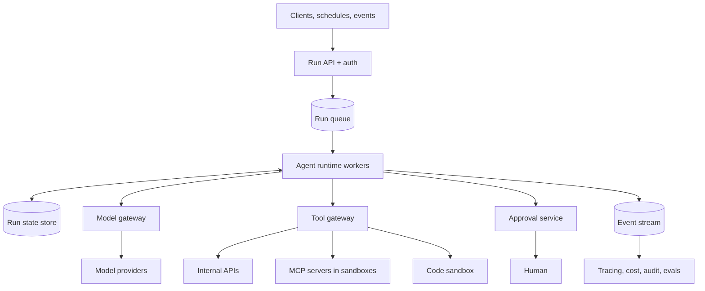

# Design an AI Agent Platform

<Outcomes items={[
  "Draw the main parts: runtime, model gateway, tool gateway, state, approvals and observability",
  "Make runs durable so a crash does not repeat side effects",
  "Control cost, safety and tenants with limits, sandboxes and budgets",
]} />

## 1. Requirements

**Functional**

- Teams define **agents** (instructions, tools, limits) and start **runs** by API, schedule or event.
- Agents call **tools**: internal APIs, other services and external MCP servers.
- Runs can take minutes, wait for **human approval**, and can be **stopped**.
- Everything is **audited**: who ran what, which tools, with what result.

**Non-functional**

- Thousands of runs per day, with fast growth.
- A crash or deploy must not lose a run or repeat a payment.
- **Isolation between teams** (data, credentials, spending).
- Hard limits on steps, time and cost for every run.
- Provider outages must not take the platform down.

## 2. Estimation

- **Runs:** 10,000 per day is about 0.12 per second on average.
- **Concurrency:** if a run lasts about 60 seconds, the average is 0.12 x 60, about **7 runs at once**. With a peak of ten times, plan for about **70**. Most of the time is spent waiting on models and tools, so workers are cheap.
- **Tokens:** an average of 8 model steps per run with about 4,000 input tokens per step (history grows) and 250 output. Input is 10,000 x 8 x 4,000 = **320 million tokens per day**. Output is 10,000 x 8 x 250 = **20 million**.
- **Cost (example $3 and $15 per million):** input 320 x 3 = $960, output 20 x 15 = $300, so about **$1,260 per day**. One runaway agent can cost more than a normal day, so limits matter as much as scale.

## 3. High-level architecture

## 4. Agent runtime and durable state

The runtime executes the agent loop (see [AI agents](../ai/agents/ai-agents.md)) as a **state machine** whose state is saved after every step.

- **Persist each step:** the history so far, the pending tool call, counters and the status (running, waiting for approval, done, failed).
- **Resume after a crash.** Another worker loads the saved state and continues. This is the same idea as a saga's saved state (see [Saga pattern](../microservices/data-consistency/saga.md)).
- **Make tool calls idempotent.** Give each call a key (run id plus step number), so a retry after a crash does not charge a card twice.
- **Write the event and the state change together** (the outbox idea from [Outbox](../microservices/data-consistency/outbox-idempotency.md)), so the event stream matches the stored state.
- **Enforce limits in the runtime:** maximum steps, maximum tokens, wall-clock timeout, and a depth limit if agents can start agents.
- **Stop requests:** a "cancel" flag that the loop checks before every step.

## 5. Model gateway

One service through which every model call goes.

- **Credentials** for providers stay here. Teams never hold provider keys.
- **Routing and fallback:** choose a model per agent or step, and switch to a backup when a provider is down.
- **Rate limiting and queuing** per tenant and per provider, with backoff on provider errors.
- **Caching** of repeated calls and use of provider prompt caching.
- **Accounting:** record tokens and cost for every call against the tenant, agent and run.
- **Logging with redaction** of personal data (see [Observability](../ai/production/observability-latency-caching.md)).

## 6. Tool gateway and sandbox

- **Tool registry:** each tool has a name, description, argument schema, an owner, the permissions it needs and a risk level.
- **Validate arguments** against the schema before running anything.
- **Act as the user or the tenant,** with credentials from a vault, never with platform-wide rights.
- **Sandbox code execution:** no network by default, no secrets, limits on CPU, memory and time, and a throw-away file system.
- **Isolate MCP servers** (see [MCP](../ai/agents/model-context-protocol.md)): run third-party servers in their own sandbox, and treat their descriptions and results as untrusted.
- **Timeouts and circuit breakers** per tool, so one slow tool does not block runs.

## 7. Safety and approvals

- **Policy per tool:** allow, needs approval, or deny (see [Guardrails](../ai/safety/guardrails-and-safety.md)).
- **Approval service:** the run pauses with its state saved, a person sees the exact action and target, and approves or rejects. Approvals expire, and an expired approval means "rejected".
- **Break the risky combination:** after a run reads untrusted content, block tools that send data out (see [Prompt injection](../ai/safety/prompt-injection-and-security.md)).
- **Kill switch:** stop one run, one agent or one tenant immediately.

## 8. Multi-tenancy and budgets

- **Isolate data and credentials** per tenant, and tag every record with a tenant id.
- **Quotas:** runs per hour, concurrent runs, tokens per day, cost per month. Reject or queue when exceeded.
- **Budgets per run** as well as per tenant, so one loop cannot drain the tenant's budget.
- **Fair scheduling:** per-tenant queues or weights, so a large tenant does not starve small ones.
- **Cost visibility:** a dashboard and alerts per tenant and agent.

## 9. Observability and evals

- **One trace per run,** with a span for every model call and tool call, and the tokens, cost and result on each span.
- **Replay a run** from its saved state and inputs to debug it.
- **Evaluation sets per agent:** tasks with known good outcomes. Run them before an agent version is published, and block regressions (see [Evals](../ai/production/evals-and-testing.md)).
- **Canary releases:** send a small share of runs to a new agent version and compare success, cost and steps.
- **Alerts:** failure rate, average steps per run, cost per run, approval backlog and stuck runs.

## 10. Failure scenarios

| Failure | What happens | What to do |
| --- | --- | --- |
| **Worker crashes mid-step** | The step may or may not have run. | Resume from saved state, and rely on idempotency keys so the tool is not applied twice. |
| **Agent loops** | Costs rise, no result. | Step, token and time limits, plus a watchdog that stops runs with no progress. |
| **Provider outage or slow** | Model calls fail. | Retry with backoff, switch to a backup model, or pause the run and resume later. |
| **Tool down or slow** | Steps fail. | Timeout, circuit breaker, return a clear error so the agent can choose another path or stop. |
| **Injected instructions in tool output** | The agent tries a harmful action. | Least privilege, blocked outbound tools after untrusted reads, approvals, and monitoring. |
| **Approval never arrives** | The run waits forever. | Expiry and notification, then treat as rejected. |
| **One tenant floods the platform** | Others are slowed. | Quotas and fair scheduling. |
| **Poison run that always fails** | It retries forever. | A retry limit, then move it to a failed state with an alert. |

## 11. Trade-offs

- **Build or buy:** managed agent platforms start fast but limit control over data, tools and cost. Building gives control and needs a team to run it.
- **Sync or async runs:** short runs can answer in the request. Long runs need a queue, saved state and a way to notify the caller.
- **One agent or several:** several add cost and complexity. Use them only for a clear reason (see [Multi-agent patterns](../ai/agents/multi-agent-patterns.md)).
- **Central or per-team gateways:** central is easier to govern and account for, and per-team gives freedom. Most platforms centralise models and tools.
- **Strict or flexible approvals:** more approvals are safer and slower. Tune by risk level.

## Common interview questions

**1. What are the main components of an agent platform?**
A run API and queue, agent runtime workers, a state store, a model gateway, a tool gateway with sandboxes, an approval service, and observability with evaluation.

**2. How do you make agent runs survive crashes?**
Save the state after every step, resume from it on another worker, and make tool calls idempotent with keys so retries do not repeat side effects.

**3. Why have a model gateway?**
One place for credentials, routing, fallback, rate limits, caching, cost accounting and logging, instead of every team doing it differently.

**4. How do you keep tools safe?**
A registry with schemas and permissions, argument validation, least-privilege credentials, sandboxed code execution, isolated MCP servers and approval for risky actions.

**5. How do you control cost?**
Limits per run (steps, tokens, time), budgets per tenant, caching, routing to smaller models, and alerts on cost per run.

**6. How do you stop one tenant from affecting others?**
Isolate data and credentials, set quotas, schedule fairly and track cost per tenant.

## Pitfalls

- Keeping run state only in memory, so a deploy loses work.
- Tools that are not safe to repeat.
- Giving the platform one powerful credential instead of per-tenant, per-user access.
- No limits on steps and cost per run.
- Running generated code with network access and secrets.
- No approval expiry, leaving runs waiting forever.
- No per-tenant accounting.

## Check yourself

<Checkpoint questions={[
  {
    q: "A worker crashes right after a tool charged a card, before saving the result. How do you avoid charging twice on resume?",
    options: ["Hope the model remembers", "Use an idempotency key for the tool call (run id and step)", "Retry with a higher temperature", "Never resume runs"],
    answer: 1,
    why: "With an idempotency key, the repeated call is recognised and not applied again.",
  },
  {
    q: "Why must every run have its own step and cost limit and not only a tenant budget?",
    options: ["It makes the model faster", "One looping run could drain the whole tenant budget", "Providers require it", "It removes the need for logs"],
    answer: 1,
    why: "Run-level limits stop a single runaway agent before it uses the tenant's whole budget.",
  },
  {
    q: "Where should provider API keys live?",
    options: ["In every team's agent code", "In the model gateway only", "In the prompt", "In the browser"],
    answer: 1,
    why: "Centralising keys in the gateway keeps them out of agent code and lets you add limits, routing and accounting.",
  },
]} />

## Key takeaways

- The platform is a run queue and runtime workers with durable state, plus a model gateway, a tool gateway, approvals and observability.
- Save state after each step, and make tool calls idempotent so crashes do not repeat side effects.
- Centralise model access and tool access: credentials, limits, routing, sandboxes and accounting.
- Limit every run (steps, tokens, time) and every tenant (quotas, budgets, fair scheduling).
- Trace every run, evaluate agents before release and plan for loops, outages and stuck approvals.
