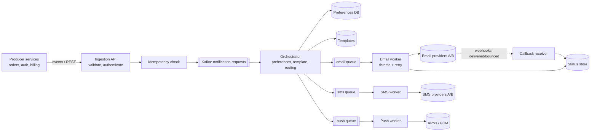

# Design a Notification Service

<Outcomes items={[
  "Design a queue-based notification pipeline",
  "Handle priority, preferences and throttling",
  "Make delivery reliable and deduplicated"
]} />

## 1. Requirements

**Functional**

- Other services submit notification requests (by API or events); the service chooses channel(s), renders content, sends and tracks status.
- Channels: email, SMS, mobile push (APNs/FCM), web push, in-app, optionally chat/webhook.
- **User preferences**: per channel/category opt-in/out, quiet hours, language.
- Templates with variables and localisation.
- Scheduling (send at 9am local time), bulk campaigns (millions), and **transactional vs marketing** distinction.
- Delivery status and history.

**Non-functional**

- **Reliable**: critical notifications (OTP, password reset, fraud alert) must not be lost; **at-least-once with deduplication** so users do not get duplicates.
- **Latency**: OTP within seconds; marketing can take minutes/hours.
- **Scalable**: spikes (a sale starts, a big incident) of millions of messages.
- **Isolated**: a bulk campaign must never delay a password-reset email (priority isolation).
- **Compliant**: consent, unsubscribe, GDPR/CAN-SPAM/TCPA, quiet hours, data retention.
- Cost-aware (SMS is expensive).

## 2. Estimation

Assume 20 M users, 3 notifications/user/day average → 60 M/day ≈ **700/s average**; campaigns and sales create peaks of **20-50×** → ~15-35 k/s for short bursts. Provider calls are the bottleneck: each email/SMS provider enforces rate limits (for example 100-1,000 messages/s per account), so **throttling and queueing** are core. Storage: 60 M × 0.5 KB metadata/day = 30 GB/day; keep hot status for 30-90 days, archive/aggregate beyond.

## 3. High-level architecture



Key ideas: **decouple** producers from delivery with a durable log/queue; run a separate **pipeline stage per concern** (accept → decide → render → deliver → track); **one queue (and worker pool) per channel and per priority** so slow SMS cannot block email and bulk cannot block transactional.

### Request contract

```text
POST /v1/notifications
Idempotency-Key: reset-pwd-user42-2026-10-17T10:15:00Z
{
  "userId": 42,
  "type": "PASSWORD_RESET",          // determines category, priority, default channels
  "channels": ["EMAIL"],             // optional override
  "templateId": "password-reset",
  "locale": "en-IN",
  "data": { "resetLink": "https://..." },
  "sendAt": null                     // or ISO timestamp for scheduling
}
-> 202 Accepted { "notificationId": "n-9f2c..." }
```

Return **202** after durably accepting (written to Kafka/outbox), never after the provider call. Producers can also publish **events** (`PaymentFailed`) and let the notification service map them to notifications; this keeps producers ignorant of channels and templates (event-driven, [Kafka design](../messaging/kafka-ordering-design.md)). Use the [outbox pattern](../microservices/data-consistency/outbox-idempotency.md) in producers so "state change + notification event" is atomic.

## 4. Priorities and isolation

| Class | Examples | Handling |
| --- | --- | --- |
| **Critical / transactional** | OTP, password reset, security alert, payment receipt | Dedicated topics/queues and workers, highest priority, tight latency alerts, multi-provider failover |
| **Standard transactional** | Order shipped, booking reminder | Normal queues |
| **Bulk / marketing** | Newsletters, promotions, digests | Separate pipeline with rate shaping, runs off-peak, quiet hours, lowest priority, can be paused |

Separate **Kafka topics/consumer groups** (or queues) per class × channel, with independent autoscaling. A marketing blast of 10 M emails must **never** sit ahead of a password reset in the same queue: head-of-line blocking is the classic design mistake.

## 5. Decisioning: preferences, consent, rules

The orchestrator, per notification:

1. Load **user preferences** and consent (cached; write-through on change): is this category allowed on this channel? Security/transactional categories may bypass marketing opt-outs but never legal opt-outs (STOP for SMS).
2. Apply **frequency capping** and **quiet hours** (user's time zone): defer or drop non-critical ones; collapse a burst into a digest.
3. Choose channels and **fallbacks** (push first; if undelivered after N minutes, send SMS for important items).
4. Resolve **template + locale**, render with variables (escape HTML for email, enforce SMS length/segments, push payload limits of ~4 KB).
5. **Deduplicate**: `notificationId` or a business key (`userId + type + entityId + time bucket`) stored with a TTL so a replayed event does not send twice.

Consent changes (unsubscribe via link, `STOP` reply, push token revoked) must take effect **immediately** and be auditable; a stale cached preference that sends a marketing email after an unsubscribe is a compliance incident.

## 6. Delivery: workers, throttling, retries

Each channel worker pulls from its queue and calls the provider:

- **Throttle** to the provider's limit (token bucket per provider/account, [rate limiter](rate-limiter.md)); excess waits in the queue (back-pressure) rather than being rejected.
- **Timeouts** on provider calls; treat a timeout as **unknown outcome**.
- **Classify failures**:

| Failure | Action |
| --- | --- |
| Transient (5xx, timeout, 429 throttled) | Retry with backoff; honour `Retry-After` |
| Permanent (invalid address, unsubscribed, invalid push token) | **Do not retry**; mark failed; update user's channel data (remove dead tokens); feed back to suppression list |
| Provider outage | Fail over to the secondary provider; open a circuit breaker for the primary ([Resilience4j](../microservices/resilience/resilience4j.md)) |
| Poison payload | Dead-letter after N attempts for inspection |

### Retries with exponential backoff and full jitter

Synchronised retries create thundering herds. **Full jitter** spreads them: wait a random time between 0 and `min(cap, base × 2^attempt)`.

```java
static long backoffMillis(int attempt, long baseMillis, long capMillis, Random rnd) {
    long ceiling = Math.min(capMillis, baseMillis * (1L << Math.min(attempt, 30)));
    return (long) (rnd.nextDouble() * ceiling);
}
```

Tested over 20 attempts × 100 samples: every delay stayed within `[0, min(cap, base·2^attempt)]`. Add a **maximum attempts / total deadline** (an OTP is worthless after 5 minutes, so expire it instead of retrying forever) and send non-critical retries to **delay topics** (non-blocking retries, as in [Kafka error handling](../messaging/kafka-ordering-design.md)) so a failing message does not block a partition.

### Idempotency and duplicates

Providers and queues are at-least-once: a worker may crash after the provider accepted the message but before recording success, causing a duplicate send on retry. Mitigations:

- Pass a **provider idempotency key** if supported (`notificationId`).
- Record `SENDING` → `SENT` with the provider message id **before/after** the call and check status on retry; for email, duplicates are an annoyance, for SMS they cost money, for OTPs they confuse users.
- Make downstream effects idempotent ([idempotent consumers](../microservices/data-consistency/outbox-idempotency.md)).

Accept that **exactly-once delivery to a human is impossible**; aim for "at-least-once with strong dedupe".

## 7. Tracking delivery

Providers report outcomes asynchronously via **webhooks** (delivered, bounced, complained, opened, clicked). Run a **callback receiver** (authenticate by signature, idempotent, fast: enqueue and return 200), update the status store, and feed bounces/complaints into suppression lists. A status model:

```text
ACCEPTED -> QUEUED -> SENDING -> SENT -> DELIVERED | BOUNCED | FAILED | SUPPRESSED | EXPIRED
```

Keep status per (notification, channel). Provide APIs for producers/support to query by id or user. Open/click tracking needs privacy consent and is unreliable (image blocking, Apple Mail Privacy Protection).

## 8. Data model

```sql
CREATE TABLE notifications (
    id            UUID PRIMARY KEY,
    user_id       BIGINT NOT NULL,
    type          VARCHAR(50) NOT NULL,
    channel       VARCHAR(10) NOT NULL,
    status        VARCHAR(20) NOT NULL,
    provider      VARCHAR(30),
    provider_msg_id VARCHAR(100),
    dedupe_key    VARCHAR(200) UNIQUE,                 -- idempotency / business key
    payload_ref   VARCHAR(200),                        -- or JSONB; keep personal data minimal
    attempts      INT NOT NULL DEFAULT 0,
    created_at    TIMESTAMPTZ NOT NULL,
    updated_at    TIMESTAMPTZ NOT NULL
);
CREATE INDEX idx_notifications_user_created ON notifications (user_id, created_at DESC);

CREATE TABLE user_preferences (user_id BIGINT, category VARCHAR(50), channel VARCHAR(10), enabled BOOLEAN NOT NULL, updated_at TIMESTAMPTZ NOT NULL, PRIMARY KEY (user_id, category, channel));
CREATE TABLE suppression_list (channel VARCHAR(10), address_hash VARCHAR(64), reason VARCHAR(30), created_at TIMESTAMPTZ NOT NULL, PRIMARY KEY (channel, address_hash));
```

Partition `notifications` by time (drop old partitions); high write volume suggests a store such as Cassandra/DynamoDB keyed by `user_id` if relational scale is exceeded ([sharding](../databases/replication-sharding.md), [NoSQL](../databases/nosql-and-redis.md)). Cache preferences in Redis with explicit invalidation.

## 9. Scheduling and bulk sends

- **Scheduled sends**: store `sendAt` and use a delayed-queue mechanism (a database table polled with `FOR UPDATE SKIP LOCKED`, Redis sorted set by timestamp, Quartz/ShedLock, or broker delay features). A scheduler tick moves due items into the delivery queue.
- **Per-user local time** (9am in the recipient's zone) requires time-zone-aware scheduling and spreads load over 24 hours naturally.
- **Campaigns**: a campaign job expands a segment into **batches** (fan-out), each enqueued into the bulk pipeline; rate-shaped to the provider limit; resumable and idempotent (checkpoint progress) so a crash mid-send does not restart from zero or double-send.
- Provide pause/cancel for campaigns and warm up sending domains/IPs gradually to protect deliverability.

## 10. Reliability and failure scenarios

| Scenario | Behaviour |
| --- | --- |
| Provider down | Circuit breaker opens; fail over to secondary; queue builds; alert |
| Kafka/queue down | Producers use outbox and buffer; ingestion API returns 503 only if it cannot persist |
| Worker crash mid-send | Message redelivered; dedupe + provider idempotency key prevents duplicates (mostly) |
| Template/render error | Dead-letter, alert the owner; do not retry endlessly |
| Preferences service down | Cached preferences; default to the safe choice per category (do not send marketing if consent unknown) |
| Spike | Queue absorbs; autoscale workers; shape bulk traffic; reject/limit abusive producers |
| Duplicate event upstream | Dedupe key suppresses second send |

## 11. Security, privacy and compliance

- Authenticate and authorise producers; per-producer rate limits and quotas so one service cannot flood users.
- **Minimise personal data** in queues/logs; encrypt at rest; mask phone/email in logs; short retention for content.
- **Consent and opt-out** honoured immediately; unsubscribe links (one-click, `List-Unsubscribe` header), SMS `STOP`.
- Prevent abuse: OTP/SMS pumping (attackers triggering costly SMS to premium numbers): rate-limit per user, IP, destination country; verify captcha before sending OTPs.
- Anti-phishing: signed domains (SPF, DKIM, DMARC) for email deliverability; monitor bounce and complaint rates.
- Audit trail of what was sent to whom and when.

## 12. Observability

Metrics: accepted/sent/delivered/bounced rates per channel and provider, queue depth and age (oldest message), end-to-end latency percentiles per priority (OTP p99 under 5 s), retry counts, DLQ size, provider error and throttle rates, cost per channel. Alerts on queue age (not just depth), delivery-rate drops and bounce spikes. Trace requests from the producing event through delivery ([observability](../microservices/observability/observability.md)).

## 13. Trade-offs

| Decision | Options | Notes |
| --- | --- | --- |
| Queue vs log | Kafka (replay, high volume) vs RabbitMQ/SQS (per-message delay, DLQ, simpler) | Kafka for ingestion/fan-out; queues for delayed retry are convenient ([RabbitMQ](../messaging/rabbitmq-basics.md)) |
| Build vs buy | In-house pipeline vs Twilio/SendGrid/OneSignal/Amazon SNS | Build the orchestration and preferences (your domain), buy delivery |
| One pipeline vs per channel | Per channel + priority | Isolation costs more infrastructure |
| Strict vs lenient dedupe | Business-key dedupe | Risk of suppressing legitimate repeat notifications: choose key and TTL carefully |
| Push vs pull for in-app | Push (WebSocket/SSE) vs polling | Pull is simpler and robust |

## Check yourself

<Checkpoint questions={[
  {
    "q": "Why use separate queues per channel and priority?",
    "options": [
      "So a slow email provider or bulk campaign cannot delay urgent messages",
      "To save money on queues",
      "Because brokers require it",
      "To avoid retries"
    ],
    "answer": 0,
    "why": "Isolation prevents head-of-line blocking."
  },
  {
    "q": "What protects against sending the same notification twice?",
    "options": [
      "A larger queue",
      "A deduplication key checked before sending",
      "Higher priority",
      "More workers"
    ],
    "answer": 1,
    "why": "Delivery is at-least-once, so dedupe on a stable id."
  },
  {
    "q": "A provider returns a temporary error. What should workers do?",
    "options": [
      "Drop the message",
      "Retry instantly forever",
      "Retry with exponential backoff and jitter, then dead-letter",
      "Mark it delivered"
    ],
    "answer": 2,
    "why": "Bounded retries with backoff avoid hammering the provider."
  }
]} />

## Common interview questions

**1. How do you ensure an OTP is delivered quickly even during a marketing blast?**
Separate priority pipelines (topics, queues, workers) per class and channel so bulk traffic cannot delay critical messages, plus multi-provider failover and tight latency alerts.

**2. How do you avoid duplicate notifications?**
Dedupe keys with a TTL at ingestion, idempotent workers with status tracking, provider idempotency keys, and accepting at-least-once delivery with strong deduplication.

**3. How do you retry failed deliveries?**
Classify errors; retry transient ones with exponential backoff and full jitter up to a deadline, never retry permanent failures, use delay topics so retries don't block, and dead-letter the rest.

**4. How do you handle provider limits and outages?**
Per-provider throttling via token buckets, queue back-pressure, circuit breakers and failover to a secondary provider.

**5. How do you respect user preferences and legal requirements?**
Central preference/consent store with immediate effect, category-aware rules, quiet hours, suppression lists, unsubscribe mechanisms and audit logs.

**6. How would you scale to bulk campaigns of millions?**
Batch fan-out jobs with checkpointing, a rate-shaped bulk pipeline separate from transactional traffic, horizontal workers, and provider throttling.

**7. How do you track delivery status?**
Provider webhooks into an authenticated, idempotent callback receiver that updates a status store, plus bounce/complaint feedback into suppression lists.

**8. How do you schedule notifications?**
A delayed-queue/scheduler (polling with `SKIP LOCKED`, sorted sets, or broker delays) that moves due items into delivery queues, with time-zone awareness.

## Pitfalls

- One shared queue for all traffic (head-of-line blocking).
- Retrying permanent failures or retrying without jitter.
- Sending synchronously from the producer's request thread.
- Cached consent that outlives an unsubscribe.
- No SMS pumping protections.
- Unbounded retries for time-sensitive messages.
- Logging full message bodies and addresses.

## Key takeaways

- Durable ingestion, then decide → render → deliver → track, with isolated per-channel/per-priority pipelines.
- At-least-once delivery with deduplication; jittered, classified, bounded retries.
- Provider throttling, circuit breakers and failover are core, not extras.
- Preferences, consent and abuse controls are product requirements, not afterthoughts.
