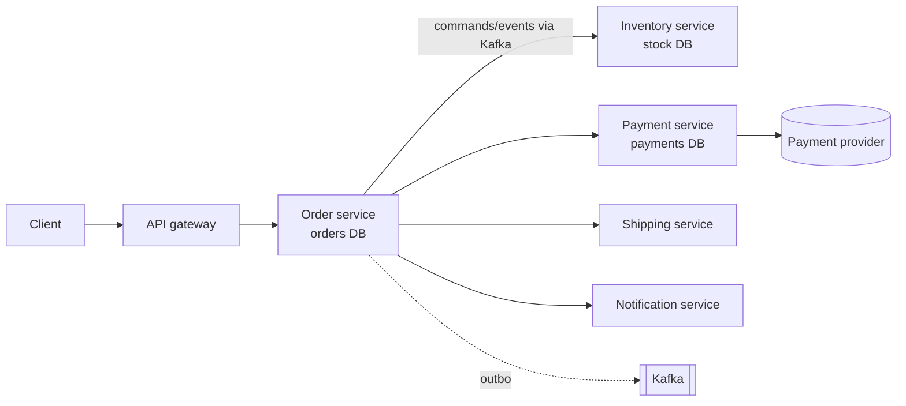
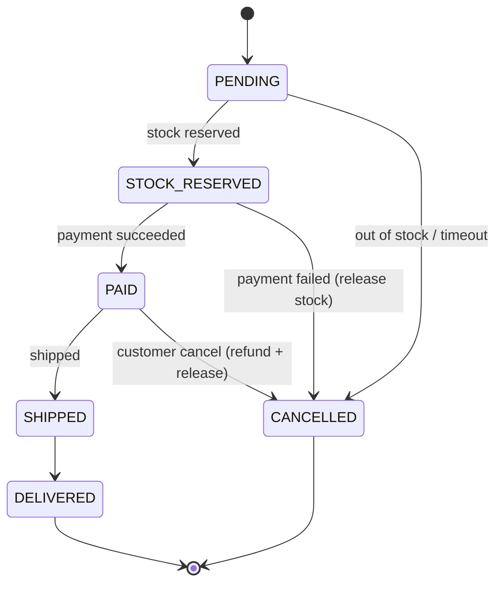
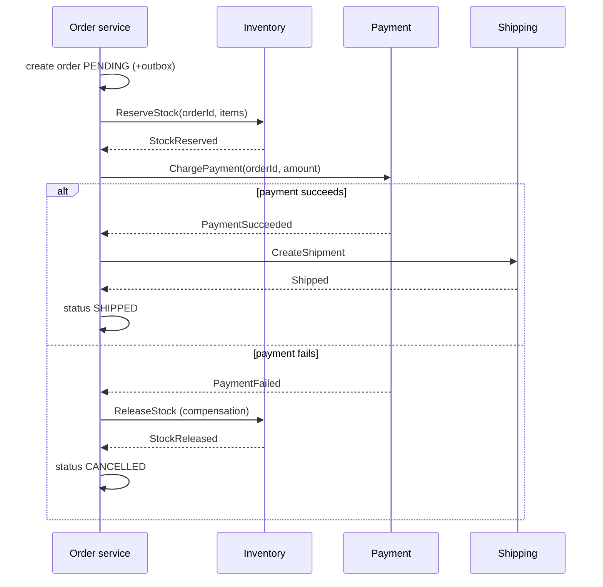

# Design an Order Processing System

Order processing is the canonical distributed-transaction problem: one business action spans **orders, inventory, payment, shipping and notifications**, each owned by a different service with its own database. The design question is how to keep money and stock **correct** when any step can fail, time out or run twice.

<Outcomes items={[
  "Model an order as a state machine",
  "Make order placement idempotent",
  "Coordinate payment and inventory with a saga"
]} />

## 1. Requirements

**Functional**

- Customer places an order from a cart; stock is reserved, payment is taken, the order is fulfilled and shipped.
- Order status can be tracked; customers can cancel before shipment (refund if paid).
- Notifications at key steps.

**Non-functional**

- **Correctness over speed** for money and stock: never charge twice, never oversell, never lose an order.
- **Availability**: browsing and placing orders should survive partial failures (payment provider slow, notification down).
- Peak: a **flash sale** at 10-50× normal load on a few hot products.
- Auditability: every state change is traceable.
- Latency: placement acknowledged in about a second; fulfilment is asynchronous.

## 2. Estimation

Assume 5 million orders/day average with a **flash-sale peak 20×** on a hot SKU:

- Average: 5 M ÷ 86,400 ≈ **58 orders/s**; peak 10×-20× ≈ **600-1,200 orders/s** (checkout API).
- Each order spawns about 6-10 internal events (reserved, paid, shipped, notification...) → ~10,000 events/s at peak: comfortable for Kafka, heavy for synchronous call chains.
- Storage: 5 M/day × 2 KB ≈ 10 GB/day ≈ 3.6 TB/year for orders plus items and events; partition by time/customer; archive old orders.
- Read traffic (status checks, order history) is higher than writes: serve from read models/caches.

## 3. Service boundaries (each owns its data)



Boundaries follow business capabilities ([decomposition](../microservices/overview.md)): **Order** (the saga coordinator and the order's lifecycle), **Inventory** (stock levels and reservations), **Payment** (wraps the payment provider, owns idempotency towards it), **Shipping**, **Notification**. No shared database.

## 4. The order state machine

An order moves through explicit states; transitions are validated, never free-form updates.

```java
public enum OrderStatus {
    PENDING, STOCK_RESERVED, PAID, SHIPPED, DELIVERED, CANCELLED;

    private static final Map<OrderStatus, Set<OrderStatus>> ALLOWED = new EnumMap<>(OrderStatus.class);
    static {
        ALLOWED.put(PENDING,        EnumSet.of(STOCK_RESERVED, CANCELLED));
        ALLOWED.put(STOCK_RESERVED, EnumSet.of(PAID, CANCELLED));
        ALLOWED.put(PAID,           EnumSet.of(SHIPPED, CANCELLED));       // cancelling a paid order triggers a refund
        ALLOWED.put(SHIPPED,        EnumSet.of(DELIVERED));
        ALLOWED.put(DELIVERED,      EnumSet.noneOf(OrderStatus.class));
        ALLOWED.put(CANCELLED,      EnumSet.noneOf(OrderStatus.class));
    }

    public boolean canTransitionTo(OrderStatus next) { return ALLOWED.get(this).contains(next); }
}

public final class Order {
    private OrderStatus status = OrderStatus.PENDING;
    private long version;                                  // optimistic locking (@Version in JPA)

    public void transitionTo(OrderStatus next) {
        if (!status.canTransitionTo(next)) {
            throw new IllegalStateException("Illegal transition " + status + " -> " + next);
        }
        status = next;
        version++;
    }
}
```

Tested: the happy path reaches `DELIVERED`; a delivered order cannot be cancelled, shipping before payment is rejected, and `CANCELLED` is terminal. Encoding the rules in one place makes duplicate or out-of-order events **safe to ignore or reject** and gives tests a clear target. Persist with an optimistic `@Version` ([locking](../spring/data/locking.md)) so concurrent updates cannot both win.



## 5. Placing an order: idempotent and fast

```text
POST /orders
Idempotency-Key: 8c1f1b7e-...        (client-generated, reused on retry)
{ "customerId": 42, "items": [ {"sku":"ABC-123","qty":2} ] }
-> 202 Accepted  { "orderId": "o-1001", "status": "PENDING" }
```

1. **Idempotency**: store the key with the resulting order id (unique constraint). A retry (timeout, double click, mobile network) returns the **same** response and does not create a second order ([idempotency](../microservices/data-consistency/outbox-idempotency.md)).
2. Validate and price the cart (prices snapshot into order lines; do not trust client prices).
3. In **one local transaction**: insert the order in `PENDING` **and an outbox row** with `OrderCreated`.
4. Return **202 Accepted** quickly; fulfilment continues asynchronously. The client polls or receives a push/SSE update.

The outbox row is published to Kafka by a relay or CDC, keyed by `orderId` so each order's events stay ordered ([Kafka ordering](../messaging/kafka-ordering-design.md)). This avoids the dual-write problem: either both the order and the event exist, or neither.

## 6. The saga

The order spans services, so use a **saga**: local transactions per service, compensations on failure ([Saga](../microservices/data-consistency/saga.md)).



**Orchestration vs choreography**: with a handful of steps, branching, timeouts and compensations, an **orchestrator** in the Order service (an explicit saga state machine persisted per order, or a workflow engine such as Temporal/Camunda) is easier to reason about, test and monitor than a web of event reactions. Choreography is fine for simple fan-out such as notifications and analytics.

### Order of steps matters

- **Reserve stock first, charge after**: charging first and failing to reserve means refunding money (visible, painful). Reserving first and failing to charge only means releasing stock.
- **Charge before shipping**; do hard-to-reverse actions (shipping, sending physical goods, emails promising delivery) **last**.
- Compensations must be **idempotent and retryable** (release stock twice = still released; refund twice must not refund twice).

### Inventory reservation

Never `SELECT stock` then `UPDATE stock` (race, oversell). Use an atomic conditional update or a locked row:

```sql
UPDATE stock SET available = available - :qty, reserved = reserved + :qty
WHERE sku = :sku AND available >= :qty;       -- 0 rows updated => out of stock
```

(see [lost updates and locking](../databases/acid-isolation-mvcc.md)). Record **reservations** (`orderId`, `sku`, `qty`, `expiresAt`) so a reservation can be released on cancel or **timeout** (a scheduled job releases reservations for orders stuck unpaid after, say, 15 minutes). "Soft" reservation at cart/checkout, "hard" decrement on payment confirmation, is a common refinement.

**Flash sales / hot SKUs**: one row updated by thousands of requests per second is a lock hotspot. Options: shard the stock counter into N sub-counters (N rows per SKU, each reserved atomically, summing for availability), keep hot stock in **Redis** with atomic `DECRBY` and reconcile asynchronously to the database, queue purchase attempts (a waiting room / virtual queue) to flatten the spike, and rate-limit per user ([rate limiter](rate-limiter.md)). Accept "sold out" fast: reject early rather than letting requests pile up in a saga.

### Payment: the most dangerous step

- Use the provider's **idempotency keys** (the order id as the key) so a retried charge request does not double-charge.
- Treat provider timeouts as **unknown outcome**: do not assume failure. Query the provider (or wait for its **webhook**) to learn the real result, then continue the saga. Reconcile periodically against provider reports.
- Authorize then capture (auth at checkout, capture when shipping) is common for physical goods.
- Never store card data (PCI scope): use the provider's tokens/hosted fields.
- Webhooks must be **authenticated** (signature check) and idempotent.

## 7. Reliability patterns used

| Problem | Pattern |
| --- | --- |
| Atomic "state change + publish event" | [Transactional outbox](../microservices/data-consistency/outbox-idempotency.md) |
| Duplicate messages / retries | Idempotent consumers with a processed-event table; unique event ids |
| Out-of-order events | Order id as Kafka key; version checks and the state machine ignore stale transitions |
| Slow/failed dependency | Timeouts, retries with jitter, circuit breaker, bulkhead ([Resilience4j](../microservices/resilience/resilience4j.md)) |
| Stuck sagas | Timeouts per step, scheduled sweeper for orders in non-terminal states too long |
| Poison messages | Bounded retries and dead-letter topics with alerting ([DLT](../messaging/kafka-ordering-design.md)) |
| Concurrent updates | Optimistic locking on the order aggregate |
| Auditability | Append-only `order_events` table (or event sourcing) with who/what/when |

## 8. Data model (Order service)

```sql
CREATE TABLE orders (
    id            UUID PRIMARY KEY,
    customer_id   BIGINT NOT NULL,
    status        VARCHAR(20) NOT NULL,
    total_amount  NUMERIC(12,2) NOT NULL,
    currency      CHAR(3) NOT NULL,
    created_at    TIMESTAMPTZ NOT NULL,
    version       BIGINT NOT NULL
);
CREATE INDEX idx_orders_customer_created ON orders (customer_id, created_at DESC);

CREATE TABLE order_items (
    order_id UUID NOT NULL REFERENCES orders(id), line_no INT NOT NULL,
    sku VARCHAR(40) NOT NULL, quantity INT NOT NULL CHECK (quantity > 0), unit_price NUMERIC(12,2) NOT NULL,
    PRIMARY KEY (order_id, line_no)
);
CREATE TABLE idempotency_keys (key UUID PRIMARY KEY, order_id UUID NOT NULL, created_at TIMESTAMPTZ NOT NULL);
CREATE TABLE outbox (id UUID PRIMARY KEY, aggregate_id UUID NOT NULL, type VARCHAR(100) NOT NULL, payload JSONB NOT NULL, created_at TIMESTAMPTZ NOT NULL, published_at TIMESTAMPTZ);
CREATE TABLE order_events (id BIGINT GENERATED ALWAYS AS IDENTITY PRIMARY KEY, order_id UUID NOT NULL, event_type VARCHAR(50) NOT NULL, details JSONB, occurred_at TIMESTAMPTZ NOT NULL);
```

Schema design principles in [relational design](../databases/relational-design.md). Shard by `customer_id` when one database is no longer enough (all of a customer's orders colocate; [sharding](../databases/replication-sharding.md)). Orders and payments use `NUMERIC` money and UTC timestamps.

## 9. Reads and CQRS

"My orders" and order-status screens are read-heavy and need data from several services. Build a **read model** (denormalised `order_summary` per order, updated from events) in the Order service or a dedicated query service backed by PostgreSQL/Elasticsearch, with Redis for hot lookups ([CQRS](../microservices/data-consistency/cqrs-event-sourcing.md)). Real-time status updates via SSE/WebSocket or polling with ETags.

## 10. Cancellation and returns

- **Before payment**: cancel the saga, release stock.
- **After payment, before shipping**: cancel, **refund** (idempotent), release stock.
- **After shipping**: not cancellation but a **return** flow (a separate process with its own states).
- Race: cancel arriving while shipping starts: the state machine plus optimistic locking makes one of them win deterministically; the loser gets a clear conflict response.

## 11. Observability and operations

- **Trace** each order across services with the order id and trace id on every log line and event ([observability](../microservices/observability/observability.md)).
- Business metrics: orders per minute by status, saga duration, payment success rate, stuck-order count, DLT size, consumer lag.
- Alerts on stuck sagas (orders `PENDING` > N minutes), reservation leaks, payment webhook failures, reconciliation mismatches.
- **Reconciliation jobs** compare orders vs payments vs stock vs shipments daily; mismatches are fixed by compensating actions, not by editing tables.
- Feature flags and safe rollouts for checkout changes ([deployment strategies](../devops/deployment-strategies.md)).

## 12. Trade-offs worth mentioning

| Decision | Choice and why | Cost |
| --- | --- | --- |
| Sync vs async fulfilment | Async with 202: resilient to slow dependencies | Eventual consistency, status polling |
| Orchestration vs choreography | Orchestrated saga for the core flow | Orchestrator is a component to build/own |
| Strong consistency across services | Not attempted; sagas + compensations | Intermediate states are visible (pending) |
| Reserve then charge | Cheaper compensation | Held stock for unpaid orders (needs timeouts) |
| One DB per service | Autonomy | No cross-service joins/transactions |
| Exactly-once | Not claimed; at-least-once + idempotency | Discipline in every handler |

## Check yourself

<Checkpoint questions={[
  {
    "q": "A client retries a payment request after a timeout. How do you avoid charging twice?",
    "options": [
      "Use an idempotency key stored with the result",
      "Hope the client does not retry",
      "Charge twice and refund",
      "Disable retries"
    ],
    "answer": 0,
    "why": "The server returns the stored result for a repeated key."
  },
  {
    "q": "Why reserve stock before charging?",
    "options": [
      "It is cheaper",
      "So you do not charge for items you cannot ship",
      "Payment providers require it",
      "It avoids the saga"
    ],
    "answer": 1,
    "why": "Order of steps affects which compensations you need."
  },
  {
    "q": "What is a benefit of an explicit order state machine?",
    "options": [
      "It removes the need for a database",
      "It makes orders instant",
      "Illegal transitions are rejected and stuck orders are easy to find",
      "It avoids events"
    ],
    "answer": 2,
    "why": "Each state change is validated and auditable."
  }
]} />

## Common interview questions

**1. How do you keep an order consistent across services without distributed transactions?**
A saga of local transactions with compensations, an outbox for atomic state-plus-event publication, and idempotent consumers; visible intermediate states are modelled explicitly.

**2. How do you avoid charging a customer twice?**
Idempotency keys on the order API and towards the payment provider, idempotent consumers, unique constraints, and reconciliation; treat timeouts as unknown outcome and confirm via query/webhook.

**3. How do you prevent overselling?**
Atomic conditional updates (`available >= qty`) or row locks, reservations with expiry, and for hot SKUs sharded counters or Redis atomic decrements reconciled to the database.

**4. What happens if the payment succeeds but the order service crashes before recording it?**
The payment event/webhook is durable (outbox/Kafka/provider webhook); on restart the consumer processes it idempotently and advances the order; reconciliation catches any gap.

**5. Orchestration or choreography here?**
Orchestration for the multi-step, branching, timeout-prone checkout flow; choreography for loosely coupled reactions like notifications.

**6. How do you handle a flash sale?**
Rate limiting and a waiting room, sharded or Redis-based stock counters, fast rejection of sold-out requests, asynchronous order creation and autoscaling with warm capacity.

**7. How do you track and debug an order?**
Order id and trace id in all logs/events, an append-only order event log, dashboards for stuck orders and saga durations.

**8. What would you do about orders stuck in `PENDING`?**
Per-step timeouts, a sweeper job that cancels and compensates, alerts and a dead-letter process for manual handling.

## Pitfalls

- Free-form status updates instead of a validated state machine.
- Charging before reserving stock.
- Treating a payment timeout as a failure and retrying without idempotency.
- Dual writes to the database and Kafka.
- Read-then-write stock checks.
- No compensation timeouts, leaving reservations leaked forever.
- Synchronous call chains across five services in the checkout request.

## Key takeaways

- Model the order as an explicit state machine; drive it with an orchestrated saga.
- Idempotency everywhere (API, events, payments); outbox for reliable events.
- Reserve before charging; do irreversible steps last; compensate idempotently.
- Plan for hot keys, stuck sagas, reconciliation and observability.
