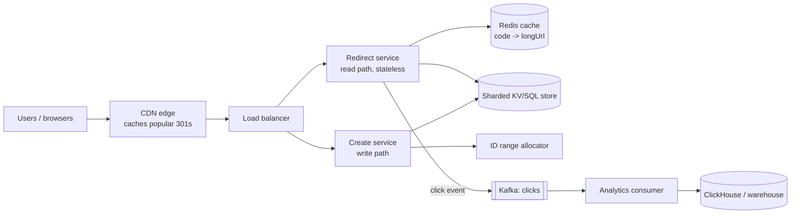

# Design a URL Shortener

<Outcomes items={[
  "Generate unique short codes and compare approaches",
  "Choose between 301 and 302 redirects",
  "Scale reads with caching"
]} />

## 1. Requirements

**Functional**

- Given a long URL, create a short URL (`https://sho.rt/aZ3x9Qk`).
- Visiting the short URL redirects to the original.
- Optional: custom alias, expiry date, delete, per-link click analytics.

**Non-functional**

- Redirect latency **p99 < 50 ms** (it is on the user's critical path).
- **High availability** for reads (a dead redirect service breaks every page that contains a link).
- Short codes are **unique** and **not guessable in sequence** (privacy: do not let people enumerate all links).
- Durable: a created link must not disappear.
- Out of scope: user accounts UI, billing.

## 2. Estimation

Assumptions: **100 million new URLs per month**, read:write = **100:1**, keep links for 5 years.

- Writes: 100 M ÷ (30 × 86,400 ≈ 2.6 M s) ≈ **40 writes/s** average (peak maybe 150/s).
- Reads: 40 × 100 = **4,000 redirects/s** average, peak **~12,000/s**.
- Records: 100 M × 12 × 5 = **6 billion** URLs.
- Size per record ~500 bytes (long URL up to 2 KB in worst cases, typically shorter; plus metadata) → 6 B × 0.5 KB = **~3 TB**; with replication ×3 ≈ 9 TB. Fits comfortably in a sharded store; not a single small server.
- Code length: with Base62 (`0-9a-zA-Z`), 7 characters give 62^7 ≈ **3.5 trillion** codes, ample for 6 billion with headroom (I verified 62^7 = 3,521,614,606,208).
- Cache: a small share of links gets most clicks (Zipf). Caching the hottest 20% of daily-read URLs: ~4,000 × 86,400 = 345 M reads/day; storing say 10 M entries × 0.5 KB = **5 GB** of cache serves a very high hit ratio.

Conclusion: **read-heavy, key-value access by short code**: ideal for caching and horizontal scaling; writes are modest.

## 3. API

```text
POST /api/v1/urls
  { "longUrl": "https://example.com/very/long/path?x=1", "customAlias": "spring-guide", "expiresAt": "2027-01-01T00:00:00Z" }
  -> 201 { "shortUrl": "https://sho.rt/aZ3x9Qk" }       (Idempotency-Key header supported)

GET /{code}
  -> 302 Found, Location: <longUrl>     (or 404 / 410 Gone if expired / deleted)

DELETE /api/v1/urls/{code}              (owner only)
GET /api/v1/urls/{code}/stats           (analytics)
```

## 4. Data model

Access pattern: **lookup by code** (point read), plus insert. No joins: a key-value or wide-column store (DynamoDB, Cassandra) fits perfectly, or sharded PostgreSQL/MySQL if you prefer one technology.

```sql
CREATE TABLE short_urls (
    code        VARCHAR(10)   PRIMARY KEY,          -- the short code, indexed by definition
    long_url    VARCHAR(2048) NOT NULL,
    owner_id    BIGINT,
    created_at  TIMESTAMP     NOT NULL,
    expires_at  TIMESTAMP
);
-- Optional: unique index on (owner_id, long_url) if "same URL -> same short code per user" is wanted
```

Shard key = **`code`** (even distribution if codes are random-looking; all lookups are by code, so every request touches one shard).

## 5. The hard part: generating unique short codes

| Approach | How | Pros | Cons |
| --- | --- | --- | --- |
| **Hash and truncate** | `Base62(first 43 bits of SHA-256(longUrl))` | Same URL gives same code, stateless | **Collisions** (birthday paradox) need detection and retry; same URL always the same code (leaks sharing) |
| **Random code + uniqueness check** | Generate 7 random Base62 chars, `INSERT`, retry on unique violation | Not guessable, simple | Collision probability grows as the table fills; needs a DB round trip |
| **Counter + Base62** | A globally unique number encoded in Base62 | No collisions, short | Sequential codes are **enumerable**; needs a distributed counter |
| **Snowflake / ID service + Base62** | 64-bit time-ordered unique ids, no coordination | Scalable, unique | Codes up to 11 chars; still roughly time-ordered |
| **Pre-generated key service** | A key-generation service (KGS) creates random unique keys in advance and hands them out in batches | Fast, no runtime collision, scalable | Another service to run; keys must be marked used; batch loss on crash is acceptable |

A strong, simple answer: a **counter-range allocator with a scramble**. Each app instance reserves a **block of ids** (for example 1,000,000 at a time) from a central counter (a database row incremented atomically, or ZooKeeper/etcd). It hands out ids from its block locally with no network call. The id is then **encoded in Base62**. To avoid guessable sequential codes, **permute** the number with a cheap bijective scramble (xor with a secret, multiply by a large number coprime to 62 (not divisible by 2 or 31) modulo 62^7, or format-preserving encryption) before encoding. Collisions are impossible because ids are unique and the permutation is a bijection.

### Base62 encoding (tested)

```java
public final class Base62 {
    private static final String ALPHABET = "0123456789abcdefghijklmnopqrstuvwxyzABCDEFGHIJKLMNOPQRSTUVWXYZ";

    public static String encode(long n) {
        if (n < 0) throw new IllegalArgumentException("negative");
        if (n == 0) return "0";
        StringBuilder sb = new StringBuilder();
        while (n > 0) {
            sb.append(ALPHABET.charAt((int) (n % 62)));
            n /= 62;
        }
        return sb.reverse().toString();
    }

    public static long decode(String s) {
        long n = 0;
        for (char c : s.toCharArray()) {
            int d = ALPHABET.indexOf(c);
            if (d < 0) throw new IllegalArgumentException("bad char " + c);
            n = n * 62 + d;
        }
        return n;
    }
}
```

I confirmed round trips for boundary values (0, 61, 62, 3843, 3844, 10⁹+7, and a number near 1.5×10¹⁷), that `61 → "Z"` and `62 → "10"`, and that seven characters cover every id below 62⁷.

### Snowflake-style 64-bit ids (when you want no central counter)

```java
public final class Snowflake {
    private static final long EPOCH = 1_735_689_600_000L;        // 2025-01-01T00:00:00Z
    private static final int NODE_BITS = 10, SEQ_BITS = 12;
    private static final long MAX_SEQ = (1L << SEQ_BITS) - 1;
    private final long nodeId;
    private final LongSupplier clockMillis;
    private long lastTimestamp = -1, sequence = 0;

    public Snowflake(long nodeId, LongSupplier clockMillis) {
        if (nodeId < 0 || nodeId >= (1L << NODE_BITS)) throw new IllegalArgumentException("node id");
        this.nodeId = nodeId;
        this.clockMillis = clockMillis;
    }

    public synchronized long nextId() {
        long ts = clockMillis.getAsLong();
        if (ts < lastTimestamp) throw new IllegalStateException("clock moved backwards by " + (lastTimestamp - ts) + " ms");
        if (ts == lastTimestamp) {
            sequence = (sequence + 1) & MAX_SEQ;
            if (sequence == 0) {                                   // 4096 ids in this ms: wait for the next ms
                while ((ts = clockMillis.getAsLong()) <= lastTimestamp) Thread.onSpinWait();
            }
        } else {
            sequence = 0;
        }
        lastTimestamp = ts;
        return ((ts - EPOCH) << (NODE_BITS + SEQ_BITS)) | (nodeId << SEQ_BITS) | sequence;
    }
}
```

Layout: 41 bits time (69 years) | 10 bits node (1,024 nodes) | 12 bits sequence (4,096 ids per ms per node). Tested: 100,000 ids from one generator were unique and strictly increasing; 400,000 ids from 8 threads on one node were all unique; the node id is recoverable from bits 12-21; a backwards clock jump is rejected rather than silently producing duplicates. Operational needs: unique node ids per instance (from a registry, Kubernetes StatefulSet ordinal), NTP discipline, and a policy for clock regressions. A 64-bit id encodes to up to 11 Base62 characters, longer than the 7 we want, which is why the range allocator is a better fit here; Snowflake shines for internal primary keys ([sharding ids](../databases/replication-sharding.md)).

### Custom aliases and collisions

Treat custom aliases as normal codes in the same namespace, **reject duplicates** via the primary-key constraint (`INSERT` fails → 409 Conflict), reserve a block of words (`api`, `admin`, `static`) and validate characters/length. A uniqueness check without a constraint races ([race conditions](../databases/acid-isolation-mvcc.md)).

## 6. High-level architecture



Split **read (redirect)** and **write (create)** paths: different scaling profiles, the redirect service stays tiny and fast.

### Redirect path (the hot path)

1. Request `GET /aZ3x9Qk`.
2. **Cache lookup** (Redis, or an in-process Caffeine in front); **cache-aside** with a TTL and a maximum size.
3. On a miss: read the store by code, populate the cache (also cache **negative results** briefly to blunt scans for non-existent codes).
4. Check expiry; return `302`/`301` with `Location`.
5. **Fire-and-forget** a click event to Kafka (never block the redirect on analytics; a failure to publish must not fail the redirect).

```java
@GetMapping("/{code}")
ResponseEntity<Void> redirect(@PathVariable String code, HttpServletRequest request) {
    return urls.resolve(code)                                          // cache-aside lookup
        .map(url -> {
            clicks.publishAsync(new ClickEvent(code, Instant.now(), request.getHeader("User-Agent")));
            return ResponseEntity.status(HttpStatus.FOUND).location(URI.create(url.longUrl())).<Void>build();
        })
        .orElseGet(() -> ResponseEntity.notFound().build());
}
```

### 301 vs 302

- **301 Moved Permanently**: browsers and CDNs **cache** it, so later clicks never hit your servers (cheaper, faster) but you **lose analytics** and cannot change/expire the target reliably.
- **302 Found (temporary)**: every click reaches you (accurate analytics, ability to expire or update) at the cost of more traffic. Choose **302** when analytics or expiry matter (most products), 301 for pure permanence. A cache-control TTL on a 302 is a compromise.

## 7. Scaling and reliability

| Concern | Approach |
| --- | --- |
| **Read throughput** | Redis cluster + in-process cache; CDN for hot links; read replicas of the store |
| **Hot keys** (a viral link) | CDN/edge caching, in-process Caffeine in each instance (request coalescing to avoid a stampede), replicate hot keys |
| **Storage** | Shard by `code` (hash/consistent hashing); 6 B rows ≈ 3 TB fits a cluster |
| **Availability** | Multiple instances across zones, store replicated (RF=3), cache failure falls back to the store (**graceful degradation**, not an outage); multi-region read replicas |
| **Cache stampede** | Single-flight per key, jittered TTLs ([Caching](../spring/data/caching.md)) |
| **Write idempotency** | `Idempotency-Key` so retries do not create duplicate codes |
| **Expiry cleanup** | Check `expires_at` on read; background job (or TTL feature of the store) removes old rows and returns codes (optional) |
| **Abuse** | Rate limit creation per user/IP ([rate limiter](rate-limiter.md)), validate scheme (`http/https` only), block malicious domains (Safe Browsing check, async re-scan), CAPTCHA for anonymous creation |
| **Privacy/security** | Unguessable codes, no PII in URLs, authz for stats/delete, HTTPS only |

### Analytics pipeline

Clicks are high volume (12,000/s peak = ~1 billion/day). Publish events to **Kafka** (keyed by `code` for per-link ordering and locality), consume into an OLAP store (ClickHouse, BigQuery) with pre-aggregation (counts per code per minute). Count with **idempotent, at-least-once** semantics; approximate counts (HyperLogLog for unique visitors) are acceptable ([Kafka design](../messaging/kafka-ordering-design.md)). Keep this off the redirect's critical path.

## 8. Failure scenarios

- **Cache down**: redirect service reads the store directly (higher latency, lower throughput) while autoscaling and circuit breakers protect the store ([resilience](../microservices/resilience/resilience4j.md)).
- **Store shard unavailable**: only codes on that shard fail; replicas serve reads; consistent hashing limits blast radius.
- **ID allocator down**: instances keep issuing from their reserved block; an exhausted block means create fails fast (alert), redirects unaffected.
- **Kafka down**: drop or buffer click events (bounded); never fail redirects.
- **Region outage**: multi-region read replicas with DNS failover; writes may be region-pinned.

## 9. Possible extensions

Link previews, QR codes, per-user dashboards, link groups, A/B redirects, geo-based targets (resolve at the edge), password-protected links, expiring one-time links.

## Check yourself

<Checkpoint questions={[
  {
    "q": "How many distinct codes does a 7-character Base62 string provide?",
    "options": [
      "About 3.5 trillion (62^7)",
      "About 62 thousand",
      "About 7 million",
      "About 7 billion only"
    ],
    "answer": 0,
    "why": "62^7 is roughly 3.5 x 10^12, plenty for most services."
  },
  {
    "q": "Why use a 302 redirect?",
    "options": [
      "It is faster for users",
      "Browsers do not cache it, so every click reaches you and can be counted",
      "It is required by HTTP",
      "It hides the long URL"
    ],
    "answer": 1,
    "why": "301 is cached and saves load but loses analytics."
  },
  {
    "q": "Reads vastly outnumber writes. What is the main scaling tool?",
    "options": [
      "Sharding writes first",
      "Adding more writers",
      "Caching hot codes in memory (for example Redis)",
      "Compressing URLs"
    ],
    "answer": 2,
    "why": "Cache popular code-to-URL mappings and keep the database as the source of truth."
  }
]} />

## Common interview questions

**1. How do you generate the short code?**
Counter-range allocation (ids reserved in blocks per instance) permuted and Base62-encoded for uniqueness without coordination per request and without guessable sequence; alternatives are random codes with collision retry or a pre-generated key service.

**2. Hash truncation vs counter?**
Hashing is stateless but collides and must be retried; counters are collision-free but sequential unless scrambled and need a distributed allocator.

**3. How many characters do you need?**
Base62 with 7 characters gives about 3.5 trillion codes, enough for billions of links with headroom.

**4. How do you make redirects fast?**
Stateless redirect service, CDN and in-process/Redis caching with cache-aside, point reads by primary key, async analytics, and 302/301 chosen deliberately.

**5. 301 or 302?**
301 is cached by clients (less load, no analytics, hard to change); 302 hits the service every time (analytics and control). Use 302 when click counting or expiry matters.

**6. How do you handle a viral link?**
Edge/CDN caching, per-instance cache with single-flight, replicate the hot key, and rate limiting at the edge.

**7. How do you scale storage?**
Shard by short code with consistent hashing in a key-value store or sharded SQL; replicate for durability; archive expired links.

**8. How would you prevent abuse and malicious URLs?**
Rate limits, authentication for bulk creation, URL validation and reputation checks (sync for new domains, async rescans), blocklists and reporting workflows.

## Pitfalls

- Sequential codes that let anyone crawl every link.
- Hash-only schemes without collision handling.
- Blocking redirects on analytics or cache population errors.
- Using 301 and then wanting analytics.
- A single ID counter as a bottleneck for every request.
- Uniqueness check without a database constraint.

## Key takeaways

- Read-heavy key-value design: cache aggressively, shard by code.
- Unique codes via allocated id ranges + scramble + Base62; Snowflake for internal ids.
- Keep analytics asynchronous and off the redirect path; degrade gracefully.
- Choose 301/302 deliberately; protect against abuse.
